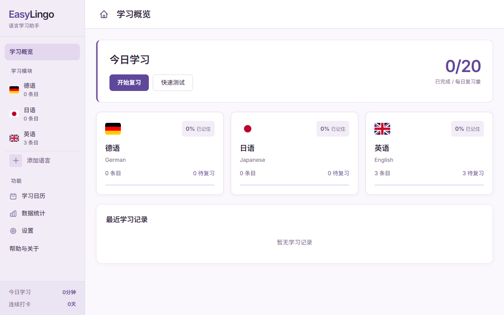
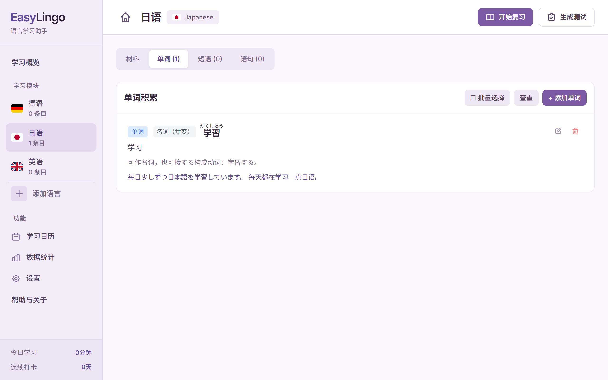

# EasyLingo

EasyLingo 是一款桌面语言学习工具，支持从材料中提取词条、间隔复习、生成测试和查看学习记录。内置德语、日语、英语模块，也可添加其他语言。

**开发者：陈挚**

**开发单位：清华大学语言教学中心**

## 下载

当前版本：**2.1.2**。全部文件见 [GitHub Releases](https://github.com/ReoNa0216/EasyLingo/releases/tag/v2.1.2)。

| 平台 | 下载 | 使用方式 |
|---|---|---|
| Windows 10/11 x64 | [安装包](https://github.com/ReoNa0216/EasyLingo/releases/download/v2.1.2/EasyLingo_2.1.2_x64-setup.exe) | 双击安装，缺少 WebView2 时安装器会引导下载 |
| macOS Apple Silicon | [DMG](https://github.com/ReoNa0216/EasyLingo/releases/download/v2.1.2/EasyLingo_2.1.2_aarch64.dmg) | 打开后将应用拖入“应用程序” |
| Windows 免安装试用 | [ZIP](https://github.com/ReoNa0216/EasyLingo/releases/download/v2.1.2/EasyLingo_2.1.2_Windows-preview.zip) | 解压后双击 `EasyLingo-2.1.2.exe` |

Windows 版本需要 Edge WebView2 Runtime。macOS 安装包适用于 Apple Silicon，未做 Apple 公证，首次打开可能需要在系统设置中确认来源。免安装试用版与正式版分别保存数据，可用 JSON 备份迁移词条和学习记录。

## 可以做什么

- **导入学习材料**：支持 TXT、Markdown、文本型 PDF 和 DOCX，也可批量输入或手动添加词条。
- **整理词条**：通过自行配置的 AI 服务生成释义、词性和例句；支持编辑、日语注音，以及自定义语言的提取要求。
- **复习与测试**：按间隔安排复习，生成选择、填空和翻译题，查看学习日历与统计。
- **阅读新闻**：英语默认 NPR，另有 China Daily、BBC 和 Guardian；日语使用人民网日语版，德语使用 ZDFheute。BBC、Guardian 标注“需代理”。

已有词条可离线阅读和复习。AI 功能和新闻抓取需要联网，软件会读取系统代理设置；修改代理后请重启应用。

## 界面预览

以下截图使用演示数据。





## 开始使用

1. 选择德语、日语、英语，或添加自己的语言模块。
2. 打开“设置”，按 [API 配置指南](docs/api-configuration.md) 填写地址、密钥、模型和输出长度。指南提供 DeepSeek 与智谱的官网配图和完整步骤，也可下载 [PDF](API_configuration.pdf)。
3. 先按指南导入三个单词，确认释义、词性和例句正常生成，再导入自己的材料。选择文件后会自动开始提取；扫描 PDF 需先进行 OCR。
4. 在词条页面查看和编辑内容，使用“开始复习”或“生成测试”。填空题保留冠词和大小写，翻译题对照参考答案自行评估。
5. 在“设置”中导出 JSON 备份。恢复备份会替换当前学习数据，恢复前请先导出一份备份。

## 数据与隐私

学习数据和 API 密钥保存在本机 SQLite 数据库。使用 AI 时，相关材料、词条和提示词会发送到您配置的服务商，费用按服务商规则收取。生成内容可结合原文核对和编辑。

JSON 备份包含词条与学习记录，不包含 API 密钥。恢复或换电脑后需重新填写密钥。

默认数据目录：

- Windows：`%APPDATA%/com.reona0216.easylingo/`
- macOS：`~/Library/Application Support/com.reona0216.easylingo/`

自定义数据目录在重启后生效。迁移顺序为：导出 JSON，选择新目录并重启，再导入 JSON。

## 从源码构建

需要 Node.js 24、Rust 1.94 或更新稳定版，以及 [Tauri v2 系统构建依赖](https://v2.tauri.app/start/prerequisites/)。

```sh
npm ci
npm run assets
npm run check
npm test
npm run test:ui
cargo test --locked --manifest-path src-tauri/Cargo.toml --lib

# Windows 安装包
npm run build:win
# Windows 免安装试用
npm run tauri -- build --no-bundle --config scripts/preview.conf.json
# Apple Silicon Mac
npm run tauri -- build --target aarch64-apple-darwin --bundles dmg
```

开发运行 `npm run dev`。浏览器回归测试默认使用已安装的 Microsoft Edge。构建会打包本地字体、图表和文件解析器。

## 更多资料

- [API 配置指南](docs/api-configuration.md)
- [自定义提示词示例](prompt-examples/)
- [版本发布记录](https://github.com/ReoNa0216/EasyLingo/releases)
- [审计与验证记录](docs/submission-audit.md)
- [MIT License](LICENSE)

本项目由 [PolyLingo](https://github.com/ReoNa0216/PolyLingo) 的桌面版本演进而来。第三方组件和字体许可证随应用资源提供。
