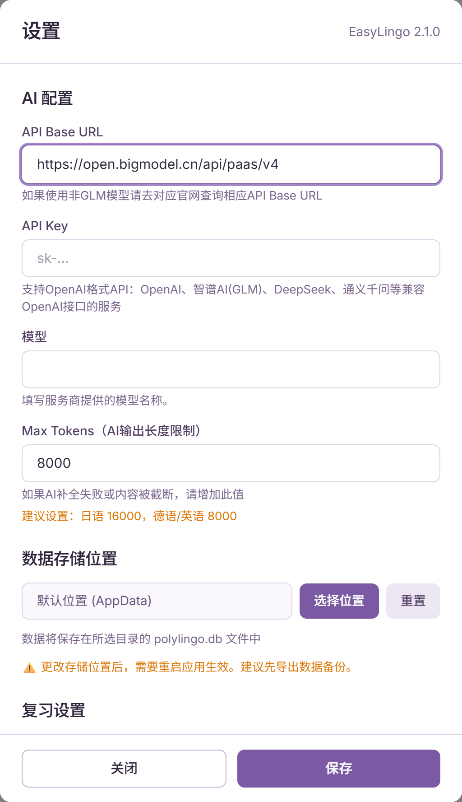

# EasyLingo API 配置指南

适用版本：2.1.0　更新日期：2026-11-16

开发者：陈挚　开发单位：清华大学语言教学中心

## 01 打开设置

点击应用左侧栏底部的「设置」。填写 API Base URL、API Key 和模型名称后，点击底部「保存」。窗口较小时，上下滚动中间区域可查看其余选项。

图中使用空密钥与空模型配置；请填写自己服务商提供的值。

## 02 填写配置

**API Base URL**：填写服务商提供的 Chat Completions 兼容接口基础地址，通常使用 HTTPS。不要附加 `/chat/completions`，应用会自动补上该路径。例如，智谱普通模型 API 的基础地址为 `https://open.bigmodel.cn/api/paas/v4`。

**API Key**：登录服务商控制台，在 API 密钥管理页面创建并复制密钥。粘贴完整内容，去掉首尾空格。密钥输入框中的 `sk-...` 只是提示，不要求所有服务商的密钥都以此开头。

**模型**：填写服务商文档或控制台给出的完整模型 ID，并确认账号具备调用权限。更换服务商时，同时更新基础地址、密钥和模型。模型可用范围与费用以该服务商当前说明为准。

**Max Tokens**：限制单次 AI 输出长度，默认值为 8000。日语词条带注音和例句时，可在模型支持的范围内提高至 16000。出现截断时，先缩短材料或减少提取量；增大此值也会增加可能的输出量和费用。该值不是输入材料的字数限制。

**每日复习量**：默认 20，用于控制每天的复习数量，与 API 额度无关。

**保存配置**：点击「保存」才会应用更改。保存本身不发送测试请求；首次提取成功后，才能确认当前账号、模型和网络均可用。

### 以智谱为例

访问 [智谱开放平台](https://bigmodel.cn/)，登录后创建 API Key。在当前模型文档中确认模型 ID、接口兼容性及账号额度，再将上述三个字段填入 EasyLingo。接口地址与密钥应属于同一服务；按量 API 与其他订阅产品的授权范围请按服务商说明核对。

官方参考：[智谱 OpenAI API 兼容文档](https://docs.bigmodel.cn/cn/guide/develop/openai/introduction)。本指南保留通用配置方法，不固定推荐某一代模型或充值金额。

### 网络与隐私

AI 请求和新闻抓取使用系统网络与代理设置；更改代理后重启应用。AI 功能会将所选材料、词条及提示词发送给配置的服务商。密钥保存在本机数据库，JSON 备份会排除密钥；请勿公开密钥或带密钥的截图。

## 03 完成首次提取

1. 选择对应语言模块，导入一小段 TXT、Markdown、文本型 PDF 或 DOCX。扫描图片型 PDF 需先进行 OCR。

2. 启动 AI 提取，等待完成后打开词条列表，核对原文、释义、例句和日语注音。成功生成并保存词条即表示这条配置流程可用。

3. 新闻导入可先选英语 NPR、China Daily 或日语人民网。BBC 与 Guardian 标注「需代理」；网站访问还取决于当前网络和来源站点状态。

### 出错时检查什么

**401 / 403 或鉴权失败**：核对密钥、账号权限，以及密钥对应的服务地址。按界面中的服务商错误说明处理。

**404 或模型不存在**：检查 Base URL 是否误填了完整请求路径、模型 ID 是否拼写正确、账号是否可用该模型。

**429、限流或额度不足**：查看服务商控制台中的余额、额度与频率限制，稍后重试；具体含义以返回的错误信息为准。

**连接失败或超时**：检查网络和系统代理，重启 EasyLingo 后重试。AI 接口可访问与新闻网站可访问是两个独立条件。

**输出截断或解析失败**：缩短材料、减少提取量；在模型允许的范围内调整 Max Tokens。若反复失败，核对服务商是否支持 Chat Completions 格式。

### 备份与换电脑

在「设置」底部选择「导出数据」，保存 JSON 备份。导入备份会替换当前学习数据，导入前先备份。恢复后重新填写 API Key。

修改「数据存储位置」后，重启应用才会生效，原有数据不会自动搬迁。迁移时先导出 JSON，再选择新目录、保存并重启，最后导入备份。已有词条的阅读和复习可离线使用。

项目与下载：[github.com/ReoNa0216/EasyLingo](https://github.com/ReoNa0216/EasyLingo)
