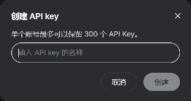
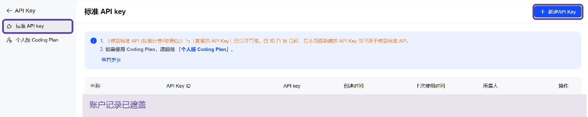

# EasyLingo API 配置指南

适用版本：2.1.3　官网核对日期：2026-11-16

开发者：陈挚（清华大学生命科学学院）

语言顾问：清华大学语言教学中心 王雯鹤 老师

**先选一家服务即可。** DeepSeek 按本页操作；智谱从第 2 页开始。取得密钥后，到第 3 页填写 EasyLingo 设置，再按第 4 页完成首次验证。已有密钥可直接看第 3 页。

## 01 DeepSeek：获取 API Key

**1. 打开密钥页面。** 点击 [DeepSeek 开放平台 API keys](https://platform.deepseek.com/api_keys)，按页面提示登录或注册。登录后，左侧选中「API keys」，右侧可以看到「创建 API key」。


截图：官网左侧「API keys」与右侧「创建 API key」按钮的局部特写。

**2. 创建密钥。** 点击「创建 API key」，在名称框中填写 `EasyLingo`，再点击「创建」。这个名称方便你日后辨认用途。



**3. 复制完整密钥。** 创建后立即复制完整 API Key，暂时保存在你自己的安全位置。列表中的星号或省略号版本不能用于配置；DeepSeek 的完整密钥只在创建时显示。

**4. 确认可用额度。** 左侧「用量信息」可查看账户用量与余额，需要时进入「充值」。API 调用按用量计费；网页聊天账户的免费使用不代表 API 有可用余额。费用可查看 [官方模型与价格](https://api-docs.deepseek.com/zh-cn/quick_start/pricing/)。

**准备完成：** 保留刚复制的密钥，跳到第 3 页，使用表格中的 DeepSeek 一列。示例模型为 `deepseek-flash`。

官方参考：[DeepSeek 首次调用 API](https://api-docs.deepseek.com/zh-cn/)。

## 02 智谱：获取标准 API Key

**1. 打开标准密钥页面。** 点击 [智谱标准 API key](https://bigmodel.cn/apikey/platform)，按提示登录或注册。确认左侧选中「标准 API key」，EasyLingo 使用这里的密钥。



截图：官网左侧「标准 API key」与右上角「新建API Key」按钮的局部特写。

**2. 创建密钥。** 点击右上角「新建API Key」，在「请输入 API Key 名称」中填写 `EasyLingo`，点击「确定」。


**3. 复制完整密钥。** 创建完成后，将平台提供的完整 API Key 复制并暂存到你自己的安全位置。EasyLingo 的「API Key」栏接收完整密钥，列表中的「API Key ID」是标识编号，不能代替密钥。

**4. 使用示例模型。** 本指南采用 `glm-4-plus`，用于词义、语法解释、翻译和短文提取。其最大输出为 4K Tokens，在 EasyLingo 中将「Max Tokens」填写为 `4000`。如平台提示实名认证或模型开通，先按页面要求完成。

**模型怎么选：** 已用 GLM-4-Plus 得到满意结果时，可继续使用。需要更长的输出可尝试 DeepSeek；希望降低费用可尝试官方列为免费的 `glm-4.7-flash`。更换后先检查几条中文释义、日语读音、德语词性和例句，再导入长材料。

**选对密钥类型：**「个人版 Coding Plan」与标准 API 的密钥分开管理。配置本指南中的接口地址时，使用「标准 API key」页面取得的密钥。

**准备完成：** 到第 3 页，使用表格中的智谱一列。

官方参考：[GLM-4-Plus 能力与输出上限](https://docs.bigmodel.cn/cn/guide/models/text/glm-4)、[GLM-4.7-Flash](https://docs.bigmodel.cn/cn/guide/models/free/glm-4.7-flash)、[模型价格](https://docs.bigmodel.cn/cn/guide/start/pricing)、[API Key 分类说明](https://docs.bigmodel.cn/cn/coding-plan/notice/api-key-management)。

## 03 将参数填入 EasyLingo

**1. 打开「设置」。** 点击 EasyLingo 左侧栏底部的「设置」。

**2. 按同一列填写以下参数。** 可以从此表复制地址和模型 ID；切换服务商时，一并更换密钥和输出长度。

| 设置中的字段 | DeepSeek | 智谱 |
| --- | --- | --- |
| API Base URL | `https://api.deepseek.com` | `https://open.bigmodel.cn/api/paas/v4` |
| API Key | 第 1 页取得的完整密钥 | 第 2 页取得的完整密钥 |
| 模型 | `deepseek-flash` | `glm-4-plus` |
| Max Tokens | `8000` | `4000` |

地址填到表中所示位置即可，EasyLingo 会自动补上 `/chat/completions`。粘贴密钥时去掉首尾空格；输入框中的 `sk-...` 只是提示文字。


**3. 保存并验证。**「Max Tokens」按上表填写，「每日复习量」可保留 `20`，点击设置底部「保存」。保存后继续下一页，实际生成词条来检查配置。

截图：以 `glm-4-plus / 4000` 演示 AI 参数区域，密钥留空。填写自己的密钥后，使用设置底部的「保存」按钮。

## 04 用三个单词完成验证

**1. 进入输入区。** 点击左侧「英语」，打开上方「材料」页签，向下找到「批量导入单词」。

**2. 粘贴下面三个单词，每行一个。**

```text
research
perspective
sustainable
```

**3. 点击「AI补全并导入」。** 弹窗会显示解析到 3 个词条以及预览；确认导入后，等待处理结束。

**4. 检查结果。** 应出现「已补全并导入 3/3 个词条」的提示，并切换到「单词」页签。查看这三个词是否有中文释义、词性和例句；这些内容完整生成并保存，就说明本次配置可以使用。已有词条时，列表总数会在原有基础上增加。

**未成功时：** 记下弹窗中的错误文字，到下一页查找对应处理办法。

### 接着导入自己的学习材料

**1. 选择语言模块。** 根据材料语言选择「英语」「日语」或「德语」，打开「材料」页签。

**2. 选择文件。** 在「导入学习材料」区域点击「选择文件」，先选一篇较短的 TXT、Markdown、DOCX 或文本型 PDF。

**3. 等待自动提取。** 选择文件后，EasyLingo 会开始读取材料并调用 AI。完成后查看「单词」「短语」「语句」中的内容，核对释义与例句。

扫描图片型 PDF 需先用 OCR 转成文字。已有词条的阅读和复习可离线使用。

### 两个常用设置

**Max Tokens** 控制单次 AI 回复的长度，以所选模型的上限为准。GLM-4-Plus 使用 `4000`，日语也保持此值；出现截断时缩短材料或减少词条数量。DeepSeek 或 GLM-4.7-Flash 可先用 `8000`，需要更长输出时用 `16000`。

**每日复习量** 默认 `20`，用于安排每天的复习数量，与 API 余额无关。

## 05 遇到问题时

先查看 EasyLingo 弹窗中的错误文字，再按对应行处理。保存设置后，重新用上一页的三个单词验证。

| 错误或现象 | 处理方法 |
| --- | --- |
| 401、鉴权失败或密钥无效 | 重新粘贴完整密钥，确认没有星号、省略号或多余空格。地址、密钥和模型须属于同一家服务。 |
| 403、无权限或需要认证 | 登录服务商控制台，按提示完成认证或开通模型；智谱需核对是否使用标准 API key。 |
| 余额或额度不足（如 402） | 查看服务商账户余额、可用额度和具体模型计费规则，补足额度后重试。 |
| 404、模型不存在或参数错误 | 对照第 3 页重新复制基础地址和模型 ID，检查是否误加了请求路径；其他参数按弹窗提示核对。 |
| 429、请求过于频繁或限流 | 稍后重试，减少同时运行的提取任务；如果错误文字指向额度问题，则检查账户额度。 |
| 连接失败或超时 | 检查网络及系统代理；修改代理后重启 EasyLingo。AI 接口与新闻网站分别检查可达性。 |
| 输出截断、解析失败或释义为空 | 减少单次词条数量或缩短材料；按模型允许范围调整 Max Tokens，再重新生成。 |

### 密钥和学习材料

API Key 保存在本机数据库中，请妥善保管。AI 功能会把所选材料或词条发送给你配置的服务商。分享截图时，遮住完整密钥、账户标识和个人信息。

### 备份与换电脑

在「设置」底部点击「导出数据」，保存 JSON 备份。导入备份会替换当前学习数据，导入前先备份；恢复后重新填写 API Key，JSON 备份不包含密钥。

修改「数据存储位置」后，重启应用才会生效。迁移顺序为：导出 JSON → 选择新目录并保存 → 重启 → 导入 JSON。

官方参考：两家服务的入口、模型与接口参数链接见第 1、2 页。截图于 2026-11-16 通过独立后台浏览器以 3 倍像素拍摄；局部特写仅保留操作控件，创建表单尚未提交。

项目与下载：[github.com/ReoNa0216/EasyLingo](https://github.com/ReoNa0216/EasyLingo)
